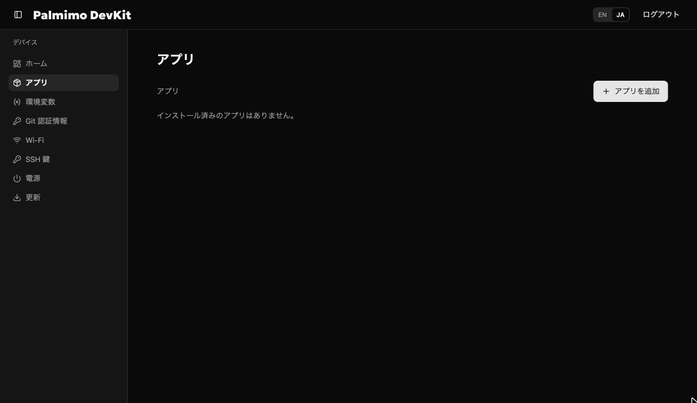
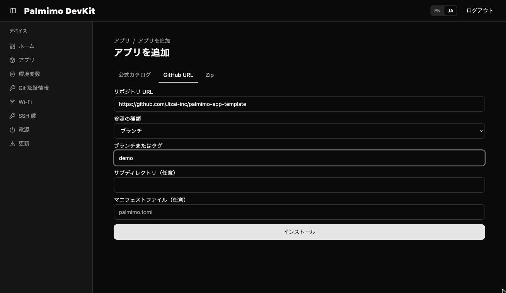
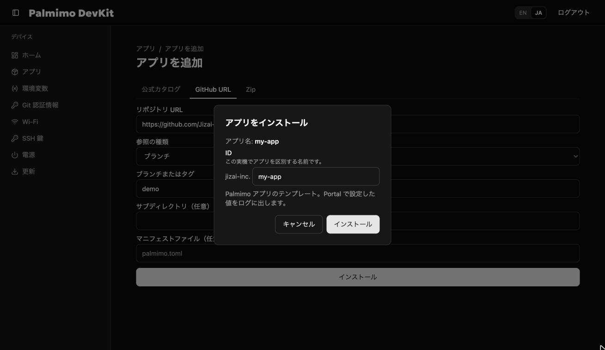
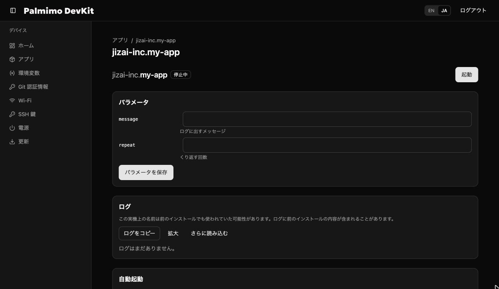
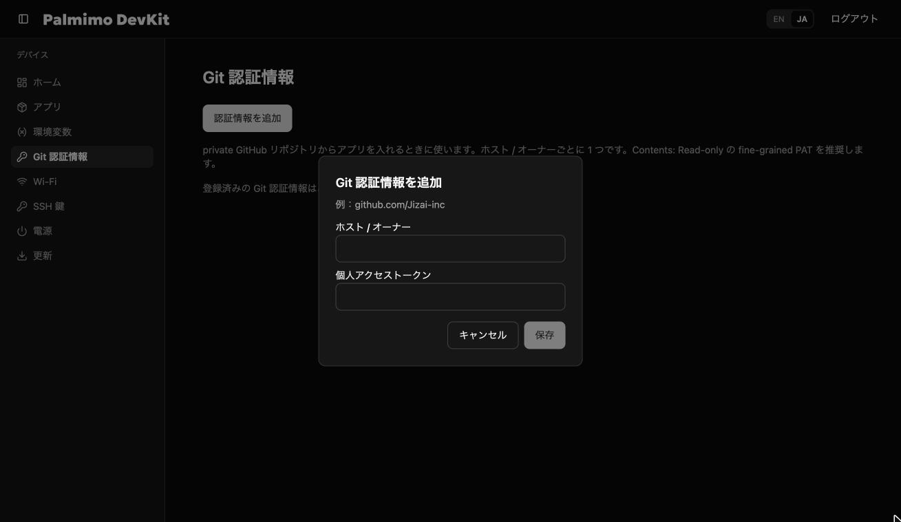
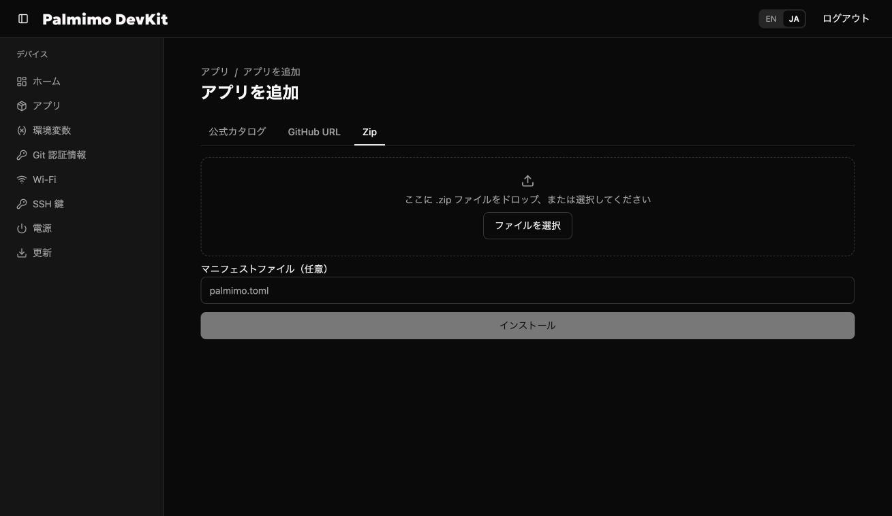
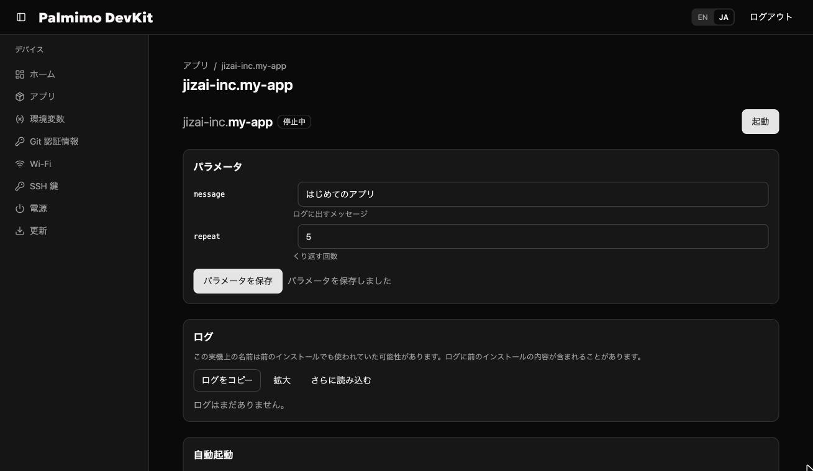
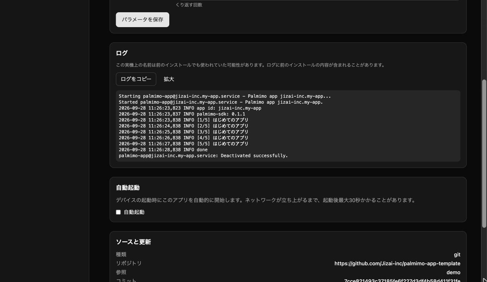
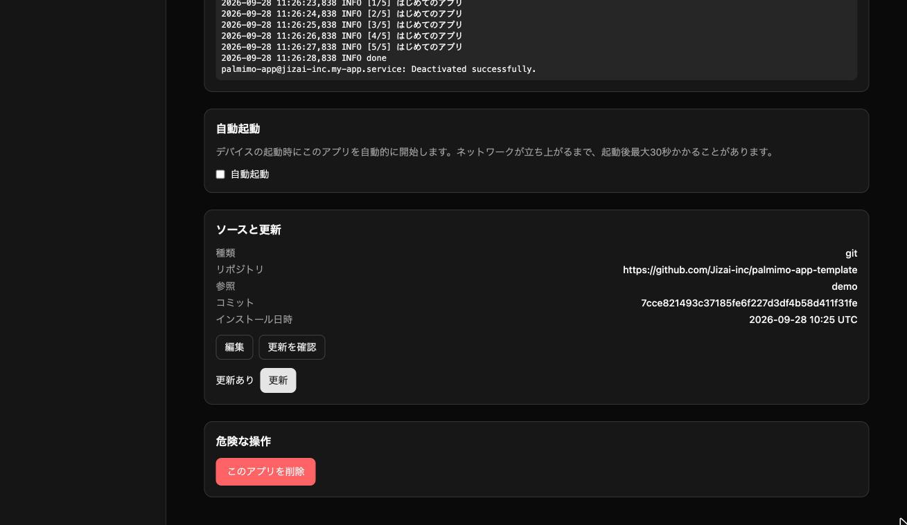
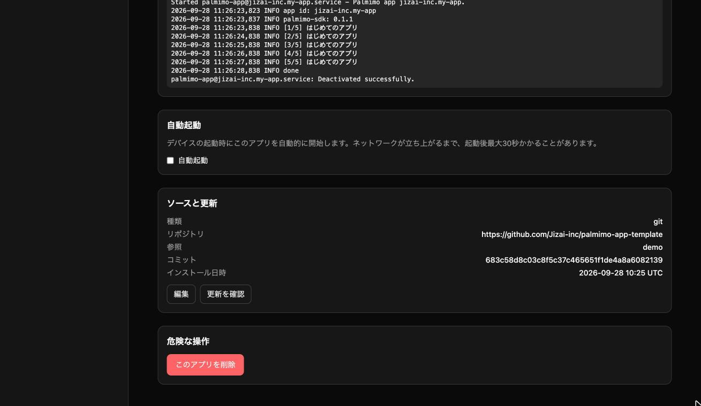

# palmimo-app-template

Palmimo DevKit で動かすアプリのテンプレートです。Palmimo Portal（DevKit の管理画面）から
インストール・起動・更新できる形になっています。

入っているもの:

| ファイル | 役割 |
|---|---|
| `palmimo.toml` | Portal がアプリを一覧に出し、設定フォームを作り、起動するための定義（schema 2 のマニフェスト）。顔ディスプレイのアセット宣言例も含みます |
| `main.py` | サンプル。Portal で設定した値をログに出すだけで、ハードウェアには触りません |
| `.gitignore` | `.venv/` などをコミットしないための設定 |

`pyproject.toml` と `uv.lock` はあえて入れていません。手順 2 で `uv init` と `uv add` を実行して作ると、
その時点の最新の palmimo-sdk が入ります。

## 1. 開発手順

### 必要なもの

- [uv](https://docs.astral.sh/uv/)
- git
- 同じネットワークにある Palmimo DevKit と、その Portal にログインできるブラウザ

このテンプレートには Portal **0.4.0 以降**と palmimo-sdk **0.2 以降**が必要です。
古い Portal は schema 2 のアプリを「新しい版が必要」として扱い、インストールしません。

### テンプレートから自分のリポジトリを作る

GitHub のこのリポジトリで **Use this template** → **Create a new repository** を選び、
自分のアカウント（または組織）にリポジトリを作って clone します。

```bash
git clone https://github.com/<owner>/<repo>.git
cd <repo>
```

### Python プロジェクトにする

```bash
uv init --app --python 3.13
uv add palmimo-sdk
```

- `uv init` は `pyproject.toml` と `.python-version` を作ります。テンプレートの `main.py`・`README.md`・`.gitignore` は上書きされません。
- `uv add palmimo-sdk` で最新の palmimo-sdk が入り、`uv.lock` ができます。
- `--python 3.13` は DevKit に入っている Python の版です。別の版を指定すると、Portal がインストール時にその版の Python を取得するので、初回のインストールに時間がかかります。

手元で動かしてみます。

```bash
uv run python main.py --message "テスト" --repeat 2
```

### アプリを作る

1. `palmimo.toml` の `name` と `description` を自分のアプリに合わせて書き換えます。
   - `name` は英小文字・数字・ハイフンで 40 文字まで（先頭は英字）です。
   - 端末上のアプリ ID は `<入れた場所>.<name>` になります。GitHub から入れたときの「入れた場所」は owner 名、zip なら `zip` です。
2. `main.py` を書き換えます。`palmimo_sdk` の使い方は [palmimo-devkit のドキュメント](https://github.com/Jizai-inc/palmimo-devkit/tree/main/doc)を参照してください。
3. 必要なら `palmimo.toml` を書き換えます。
   - `command`: 起動するコマンド。アプリのディレクトリで `uv run` を通して実行されます。
   - `[params.*]`: Portal の画面から変えられる設定。`command` の中の `{名前}` が設定値に置き換わります。
   - `devices`: サーボ・顔ディスプレイ（`motor_display`）、カメラ（`camera`）、マイク・スピーカー（`audio`）を使うときに宣言します。宣言しないデバイスはアプリから開けません。
   - `[env.*]`: API キーなどの秘密の値。値は Portal の「環境変数」画面で入れます。
   - `[assets.*]`: 顔ディスプレイに出す画像やアニメーション。[顔ディスプレイにアセットを出す](#顔ディスプレイにアセットを出す)を参照してください。

   書き方の全体は [マニフェストの仕様](https://github.com/Jizai-inc/palmimo-devkit/blob/main/doc/reference/app-manifest.md)にあります。

4. `pyproject.toml`・`uv.lock`・`.python-version` も含めてコミットし、push します。

```bash
git add .
git commit -m "My first Palmimo app"
git push
```

`uv.lock` は必ずコミットしてください。Portal は `uv.lock` どおりに依存を入れるので、手元と DevKit で同じ版がそろいます。

### 顔ディスプレイにアセットを出す

自分の絵やアニメーションを使うときは、Lottie（`.json`）・GIF・PNG・JPEG のファイルを
アプリのリポジトリに置きます。Portal はインストール時にファイルを変換し、変換できなければ
インストールは失敗します。対応する Lottie の機能やサイズなどの制限は
[palmimo-image のアセット仕様](https://github.com/Jizai-inc/palmimo-image/blob/main/doc/display-assets.md#変換器)を参照してください。
アセットを使わなければ、テンプレートのコメント例を有効にする必要はありません。

たとえば `assets/welcome.json` を置き、`palmimo.toml` に次のように宣言します。
`schema` と `devices` は、既存のトップレベルの項目を書き換えてください（`[params.*]` などのテーブルより前に置きます）。

```toml
schema = 2
devices = ["motor_display"]

[assets.welcome]
file = "assets/welcome.json"
description = "来場者を迎える笑顔"
tags = ["greeting"]

[assets.welcome.params.eye_color]
description = "目の色（RGBA、各 0〜1）"
```

`file` はアプリのディレクトリからの相対パスで、`..` やシンボリックリンクは使えません。
`description` には、いつ使うアセットかをエージェントに伝える説明を書きます。
`tags` は語彙を絞り込むための任意のタグです。
`[assets.welcome.params.eye_color]` は、その Lottie にある `eye_color` スロットを実行時に変更する場合だけ宣言します。
別のスロット名ならそれに合わせ、スロットを使わない Lottie や GIF・PNG・JPEG ではこのテーブルを省きます。
宣言していないスロットは既定値のままで、エージェントには提示されません。

Portal から起動したアプリでは、環境変数 `PALMIMO_APP_ID` に端末上のアプリ ID が入ります。
アプリのアセット ID は `<アプリ ID>/<name>`（例: `zip.my-app/welcome`）です。
上の宣言を使って、`main.py` から再生する最小の例です。

```python
import os
import time

from palmimo_sdk import FaceDisplay

display = FaceDisplay()
display.connect()
try:
    display.play(f"{os.environ['PALMIMO_APP_ID']}/welcome", hold_ms=2000)
    time.sleep(2)
finally:
    display.disconnect()
```

`play(id, hold_ms=None)` はアセットをループ再生し、正の整数の `hold_ms` を指定すると
そのミリ秒数の後に待機画面へ戻ります。省略すると次の表示コマンドまで再生します。
標準アセットも `display.play("palmimo/happy", hold_ms=2000)` のように再生でき、`[assets.*]` への宣言は不要です。
どちらの再生にも `devices = ["motor_display"]` の宣言が必要です。
エージェント向けには `play_asset(id, hold_ms=None, params=None)` があり、宣言したスロットを `params` で変更できます。
API の詳細は [SDK の FaceDisplay](https://github.com/Jizai-inc/palmimo-devkit/blob/main/doc/ja/reference/api-reference.md#facedisplay)と
[エージェントの表示語彙](https://github.com/Jizai-inc/palmimo-devkit/blob/main/doc/ja/reference/api-reference.md#エージェントの表示語彙)を、
宣言の全体は[マニフェストの仕様](https://github.com/Jizai-inc/palmimo-devkit/blob/main/doc/ja/reference/app-manifest.md#ディスプレイのアセット)を参照してください。

## 2. DevKit へのインストール（アップロード）

入れ方は 3 つあります。**GitHub から入れるのがおすすめです**。push するだけで、あとから Portal で更新できます。

### GitHub から入れる（公開リポジトリ）

1. Portal の **アプリ** を開き、**アプリを追加** を押します。

   

2. **GitHub URL** タブで、リポジトリの URL とブランチ（またはタグ）を入れて **インストール** を押します。
   `palmimo.toml` がリポジトリの直下にないときは、**サブディレクトリ** にそのディレクトリを入れます。

   

3. 確認画面で **ID**（端末上の名前）を確かめて **インストール** を押します。同じ名前のアプリがすでにあると `-2` などが付きます。ここで名前を変えることもできます。

   

4. インストールが終わると、アプリの画面が開きます。

   

### GitHub から入れる（非公開リポジトリ）

非公開リポジトリは、先に Portal にアクセストークンを登録します。

1. GitHub で **fine-grained personal access token** を作ります。対象のリポジトリを選び、権限は **Contents: Read-only** だけにします。
2. Portal の **Git 認証情報** → **認証情報を追加** で、**ホスト / オーナー**（例: `github.com/<owner>`）とトークンを入れて保存します。
   登録はオーナーごとに 1 つで、同じオーナーでもう一度保存すると置き換わります。

   

3. あとは公開リポジトリと同じ手順で入れます。

### zip で入れる

GitHub を使わないときは zip でも入れられます。ただし **zip で入れたアプリには更新機能がありません**（後述）。

1. zip を作ります。`git archive` を使うと、コミットしたファイルだけが入ります。`.venv/` は入れないでください（シンボリックリンクを含む zip はインストールできません）。

   ```bash
   git archive -o my-app.zip HEAD
   ```

2. **アプリを追加** の **Zip** タブで zip を選び、**インストール** を押します。

   

zip は 200 MB まで、展開後の合計は 1 GB までです。

## 3. 起動と設定

1. アプリの画面の **パラメータ** で値を入れて **パラメータを保存** を押します。

   

2. 右上の **起動** を押すと、**ログ** にアプリの出力が出ます。止めるときは **停止** を押します。

   

- **自動起動** にチェックを入れると、DevKit の電源を入れたときにこのアプリが自動で起動します。
- アプリの起動中は、ほかのアプリのインストール・更新・削除はできません。

## 4. アップデート

### GitHub から入れたアプリ

1. 手元で変更してコミットし、GitHub に push します。依存を増やしたときは `uv.lock` もコミットします。

   ```bash
   git commit -am "Update my app"
   git push
   ```

2. Portal のアプリの画面の **ソースと更新** で **更新を確認** を押します。新しいコミットがあると **更新あり** と出るので、**更新** を押します。

   

3. 更新が終わると、**コミット** が push したものに変わります。パラメータ・自動起動・環境変数の設定はそのまま残ります。

   

- 起動中のアプリは更新できません。先に **停止** してください。
- 入れるブランチやタグを変えるときは、**ソースと更新** の **編集** から変えます。
- タグで入れた場合は、新しいタグを作って **編集** でそのタグに切り替えます。

### zip で入れたアプリ

zip で入れたアプリは更新できません。アプリの画面の **このアプリを削除** で削除してから、新しい zip を入れ直してください。
パラメータなどの設定は入れ直すと消えるので、控えておいてください。

## 困ったとき

- **インストールで失敗する**: エラーの内容はダイアログに出ます。多いのは次のものです。
  - `palmimo.toml` の書き方の誤り
  - `pyproject.toml` や `uv.lock` のコミット忘れ
  - 非公開リポジトリで Git 認証情報を登録していない
- **起動してすぐ止まる**: **ログ** にエラーが出ます。手元で `uv run python main.py` が動くかを先に確かめてください。
- **マニフェストの細かい仕様**: [app-manifest.md](https://github.com/Jizai-inc/palmimo-devkit/blob/main/doc/reference/app-manifest.md)
